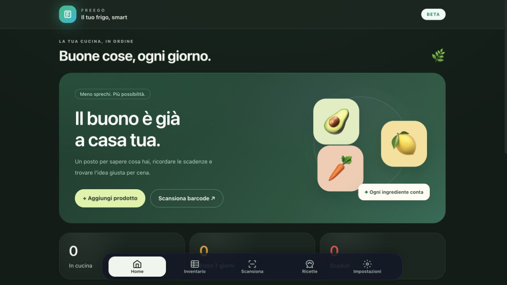
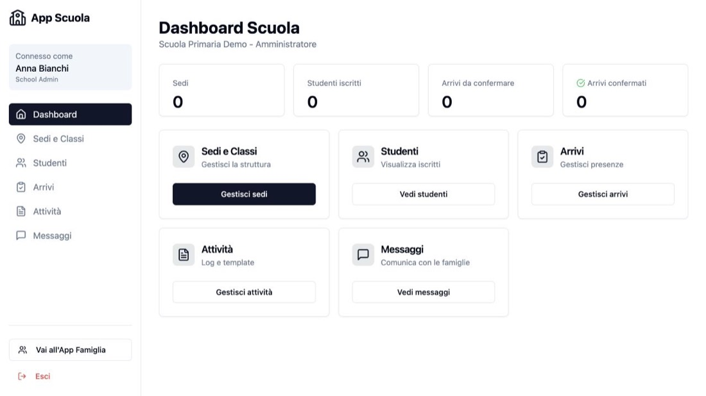

# Ciao, sono Gianluca 👋
### Dall’idea alla prima versione funzionante.

Costruisco **applicazioni web, strumenti AI ed esperienze interattive**. 
Unisco sviluppo, product design e attenzione a chi userà il prodotto.

**AI Product Builder · Italia**

[🌐 Portfolio](https://gbernardo.framer.ai/) &nbsp; · &nbsp; [✉️ Parliamo del tuo progetto](mailto:gianlucabernardo@hotmail.com)

---

## 🚀 Cosa costruisco

### 🥬 FreeGo — Il frigo diventa un’app

Cosa c’è in frigo? Cosa sta per scadere? Cosa cucino stasera? **FreeGo** parte da queste tre domande e le riunisce in un’esperienza semplice, tra inventario, scadenze e idee per le ricette.

`Next.js` `React` `TypeScript` &nbsp; · &nbsp; **Beta · codice proprietario**

**[Apri FreeGo →](https://freego26.vercel.app/)**

### 🌿 CRM Benessere — Dal cliente al rinnovo

Un prototipo gestionale per seguire **clienti, contratti, rinnovi e provvigioni**, con accessi differenziati per ruolo. Il progetto integra Supabase, Stripe in modalità test e un assistente AI lato server.

Qui il lavoro si concentra sui **flussi operativi e sulle autorizzazioni dei dati**, oltre che sull’interfaccia.

`React` `TypeScript` `Supabase` `Stripe` &nbsp; · &nbsp; **Prototipo**

**[Esplora codice e architettura →](https://github.com/Pnda90/demo-crm-benessere)**

### 🏫 Famiglia-Scuola Connessa — Un’interfaccia, più punti di vista

Percorsi dedicati a **famiglie, docenti e amministrazione**, per esplorare come organizzare la comunicazione e le attività scolastiche.

`React` `TypeScript` &nbsp; · &nbsp; **MVP dimostrativo**

La demo usa dati locali in `localStorage` e autenticazione simulata; non è collegata a un backend.

**[Prova la demo →](https://famiglia-scuola-connessa.vercel.app/)** &nbsp; · &nbsp; [Codice](https://github.com/Pnda90/famiglia-scuola-connessa)

### 🎮 Peto Quest · Deep Gut — Il lato giocoso

Un runner arcade tra ostacoli, missioni e potenziamenti. Un laboratorio per lavorare su **interazione, ritmo di gioco e identità visiva**.

`Phaser 3` `TypeScript` `Vite` &nbsp; · &nbsp; **Giocabile in locale**

**[Scopri il gioco e avvialo →](https://github.com/Pnda90/Peto_quest_v1.0)**

---

## 🧩 Strumenti per chi costruisce con l’AI

| Progetto | A cosa serve |
| :--- | :--- |
| **[Agents.md Generator](https://github.com/Pnda90/Agents.md-Generator)** | Analizzare un repository e generare, verificare o aggiornare `AGENTS.md` tramite un provider LLM. |
| **[AgentiPRO](https://github.com/Pnda90/AgentiPRO)** | Definizioni di agenti, checklist e workflow per lo sviluppo assistito da AI. |
| **JANUS** | Esplorare linguaggi e grammatiche per workflow agentic. Repository non pubblico. |

## 🇮🇹 Strumenti internazionali, accessibili in italiano

Mi occupo anche di **traduzione e adattamento per la comunità italiana**, dando credito ai lavori di partenza.

- **[TokenZip](https://github.com/Pnda90/TokenZip)** — Adattamento italiano dei concetti di *caveman*, di Julius Brussee, per interazioni più concise con gli agenti AI.
- **[WikiSkills](https://github.com/Pnda90/WikiSkills)** — Traduzione e adattamento del lavoro di *virgiliojr94*, per organizzare documenti in materiale consultabile dagli agenti.

<b>🔎 Altri esperimenti e progetti</b>

- **[YAKU](https://yaku-psi.vercel.app/)** — Gioco strategico con dadi; codice proprietario.
- **[Nocturna](https://github.com/Pnda90/Nocturna)** — Esperienza narrativa interattiva.
- **[Behind The Overlay per Safari](https://github.com/Pnda90/Behind-The-Overlay-Estensione-Safari)** — Porting per Safari di un’estensione per rimuovere popup e overlay.

## 🛠️ Nella mia cassetta degli attrezzi

**Interfacce** &nbsp; `TypeScript` `React` `Next.js` `Vite` `Tailwind CSS`  
**Backend e dati** &nbsp; `Python` `Node.js` `PostgreSQL` `Supabase`  
**AI** &nbsp; Integrazione LLM · workflow agentic · strumenti di contesto  
**Design e pubblicazione** &nbsp; `Figma` `Framer` `Vercel` `GitHub Actions`

---

### Hai un’idea da mettere alla prova?

Collaboro su **prototipi web, integrazioni AI e strumenti per developer**.

**[Scrivimi →](mailto:gianlucabernardo@hotmail.com)** &nbsp; · &nbsp; [Visita il portfolio](https://gbernardo.framer.ai/)

